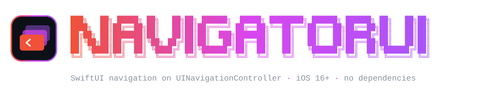
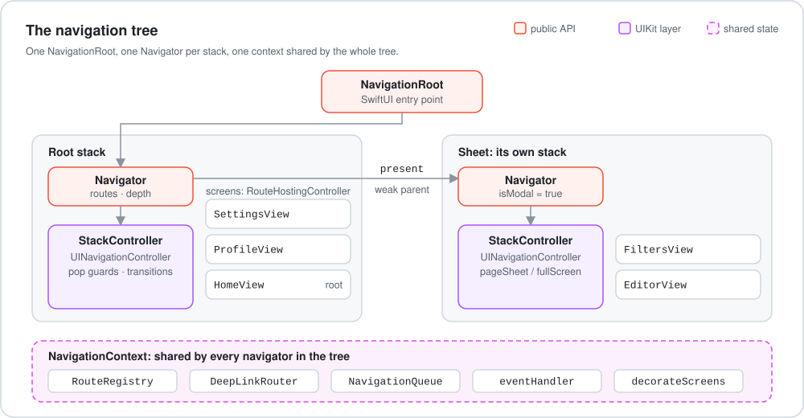
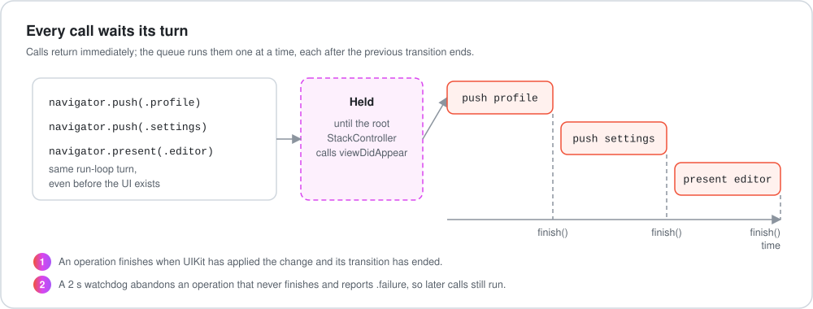
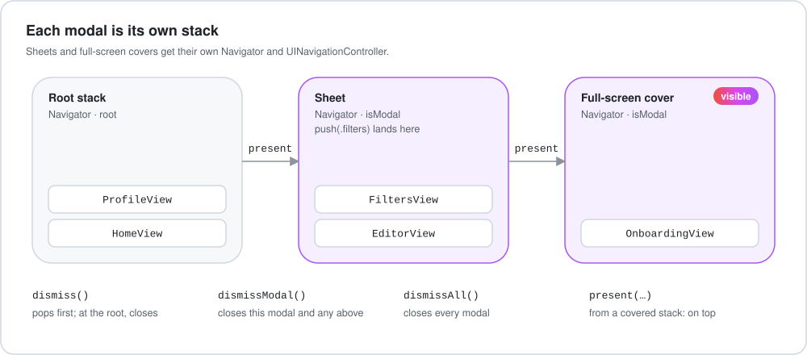
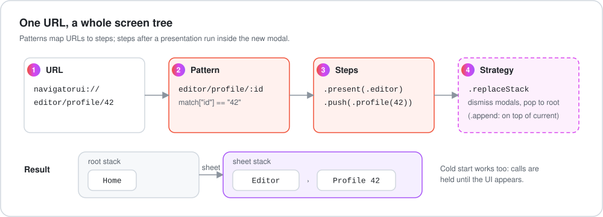

<p align="center">
  
</p>

<p align="center">
  Push, present, guard and deep-link SwiftUI screens on real <code>UINavigationController</code> stacks.
</p>

<p align="center">
  <a href="#quick-start">Quick start</a> · <a href="docs/ARCHITECTURE.md">Architecture</a> · <a href="Example">Example app</a> · <a href="docs/ROADMAP.md">Roadmap</a> · <a href="https://github.com/RafaSG13/NavigatorUI/issues">Issues</a>
</p>

<p align="center">
  
  
  
  
  <a href="LICENSE"></a>
</p>

**A navigation library for SwiftUI apps, built on `UINavigationController` instead of `NavigationStack`.**

Every stack (the root and each sheet or full-screen cover) is a real `UINavigationController`, and every screen is a `UIHostingController`. That gives you what `NavigationStack` does not expose: an inspectable stack, pop interception, serialized transitions, and custom animations. Screens are still plain SwiftUI views.

<table>
  <tr>
    <td><b>One route type per feature</b></td>
    <td><code>Route</code> is just <code>Hashable</code>. Push or present the same route; the presentation is chosen at the call site.</td>
  </tr>
  <tr>
    <td><b>Inspect and edit the stack</b></td>
    <td><code>routes</code>, <code>depth</code>, <code>pop(to:)</code>, <code>popToRoot()</code>, <code>setStack(_:)</code>.</td>
  </tr>
  <tr>
    <td><b>Pop guards</b></td>
    <td><code>.popGuard { ... }</code> blocks the back button, swipe-back and programmatic pops.</td>
  </tr>
  <tr>
    <td><b>Safe call ordering</b></td>
    <td>Calls are queued and run one at a time, each after the previous transition ends. <code>push(a); push(b); present(c)</code> is safe, and so is calling before the UI exists.</td>
  </tr>
  <tr>
    <td><b>Modals with their own stacks</b></td>
    <td>Sheets (detents, grabber, dismiss control) and full-screen covers, with <code>onDismiss</code>.</td>
  </tr>
  <tr>
    <td><b>Deep links</b></td>
    <td>Pattern matching, multi-screen stacks, sheets followed by pushes inside them, universal links, cold start.</td>
  </tr>
  <tr>
    <td><b>Custom transitions</b></td>
    <td><code>.fade</code> built in, or bring your own <code>UIViewControllerAnimatedTransitioning</code>.</td>
  </tr>
  <tr>
    <td><b>Events</b></td>
    <td>One handler receives every stack change, presentation, dismissal, blocked pop and failure.</td>
  </tr>
</table>

<p align="center">
  
</p>

---

## Installation

Swift Package Manager:

```swift
dependencies: [
    .package(url: "https://github.com/RafaSG13/NavigatorUI.git", branch: "main")
],
targets: [
    .target(
        name: "MyApp",
        dependencies: [.product(name: "NavigatorUI", package: "NavigatorUI")]
    )
]
```

In Xcode: **File ▸ Add Package Dependencies…**, paste `https://github.com/RafaSG13/NavigatorUI.git` and choose the rule **Branch: main**.

No version tags exist yet; pinning to a version is on the [roadmap](docs/ROADMAP.md).

### Requirements

| | |
|---|---|
| iOS | 16.0 |
| Swift | 6.1 (`swift-tools-version` 6.1, Swift 6 language mode) |
| Xcode | 16.3+ |
| Dependencies | None (SwiftUI, UIKit, OSLog, Foundation) |
| Platforms | iOS only (UIKit). macOS, Mac Catalyst and visionOS are not supported. |

## Quick start

1. Declare a `Route`.
2. Register its views in a `RouteRegistry`.
3. Put a `NavigationRoot` where a `NavigationStack` would go, and navigate with `@Environment(\.navigator)`.

```swift
import NavigatorUI
import SwiftUI

enum AppRoute: Route {
    case home
    case profile(id: String)
    case editor
}

@main
struct MyApp: App {
    let registry: RouteRegistry = {
        let registry = RouteRegistry()
        registry.register(AppRoute.self) { route in
            switch route {
            case .home: HomeView()
            case .profile(let id): ProfileView(id: id)
            case .editor: EditorView()
            }
        }
        return registry
    }()

    var body: some Scene {
        WindowGroup {
            NavigationRoot(registry: registry, root: AppRoute.home)
        }
    }
}

struct HomeView: View {
    @Environment(\.navigator) private var navigator

    var body: some View {
        List {
            Button("Profile") { navigator.push(AppRoute.profile(id: "42")) }
            Button("Edit") { navigator.present(AppRoute.editor, style: .sheet(detents: [.medium, .large])) }
        }
        .navigationTitle("Home") // titles and toolbars work as usual
    }
}
```

## How it works

Every public call (`push`, `present`, `open`, ...) is enqueued and runs when the previous transition has finished, so rapid or same-turn calls never fight UIKit. Calls made before the UI exists wait until the root stack has appeared. Each modal gets a child `Navigator` with its own `UINavigationController`; all navigators in a tree share one `NavigationContext` (route registry, deep-link router, event handler, queue). Internals are in [docs/ARCHITECTURE.md](docs/ARCHITECTURE.md).

<p align="center">
  
</p>

## Guide

### Rules

- **Do not put a `NavigationStack` inside a screen.** `NavigationRoot` already provides the navigation controller.
- **Environment objects above `NavigationRoot` do not reach screens**, because screens are hosted in UIKit. Inject them with `.decorateScreens { $0.environmentObject(store) }`. Dark mode, dynamic type and layout direction pass through UIKit normally.
- **Screens are built once**, when pushed or presented. A screen that must react to later state owns or observes that state itself.
- **Views outside a `NavigationRoot`** (previews) get an inert navigator. Calls are dropped and logged, never crash.

### Stack

```swift
navigator.push(AppRoute.profile(id: "42"))
navigator.push(AppRoute.settings, transition: .fade)
navigator.pop()                              // or pop(3)
navigator.pop(to: AppRoute.home)
navigator.popToRoot()
navigator.setStack([AppRoute.home, AppRoute.profile(id: "42")]) // keeps matching screens
navigator.routes, navigator.depth            // observable
navigator.routes(of: AppRoute.self)          // the routes of one type, bottom to top
navigator.contains(AppRoute.settings)        // is this route in the stack?
```

`setStack` replaces everything above the root screen and keeps matching screens from the bottom. It ignores pop guards.

### Modals

```swift
navigator.present(AppRoute.editor)                                   // sheet
navigator.present(AppRoute.editor, style: .sheet(detents: [.medium, .large], showsGrabber: true))
navigator.present(AppRoute.onboarding, style: .fullScreen(), onDismiss: { ... })
navigator.dismiss()        // pops if the stack has more than its root, otherwise closes the modal
navigator.dismissModal()   // closes this modal whatever its depth
navigator.dismissAll()     // closes every modal
```

Each modal has its own `Navigator`. `push` from inside a sheet pushes inside the sheet. A navigator only affects its own stack, so `present` from a screen that is covered by a modal presents on top of the visible one.

Sheet detents are `SheetDetent.medium` and `.large`. Full-screen covers use `FullScreenTransition.coverVertical` (default), `.crossDissolve` or `.flipHorizontal`. `onDismiss` fires once per modal, whatever closed it: a swipe, `dismiss`, `dismissModal`, `dismissAll` or a `.replaceStack` deep link.

<p align="center">
  
</p>

### Pop guards

```swift
EditorView()
    .popGuard {
        guard model.hasUnsavedChanges else { return true }
        model.confirmingDiscard = true      // show your confirmation
        return false                        // refuse this pop
    }
// in the confirmation: navigator.pop(force: true)
```

| Path | Guard consulted |
|---|---|
| Back button | Yes |
| Swipe-back | Yes (the gesture does not start) |
| `pop`, `popToRoot`, `pop(to:)` | Yes, for every screen removed |
| `dismiss()` with more than the root on the stack | Yes |
| Any of the above with `force: true` | No |
| `setStack`, `.replaceStack` deep links | No |
| Closing a modal (`dismiss()` at its root, `dismissModal`, `dismissAll`) | No |
| Swiping a sheet down | No; use `.sheet(isDismissDisabled: true, onDismissAttempt: { … })` |

A refused pop emits `.popBlocked`.

### Deep links

```swift
let links = DeepLinkRouter()
links.register("profile/:id") { [.push(AppRoute.profile(id: $0["id"] ?? ""))] }
links.register("profile/:id/settings") { match in
    [.push(AppRoute.profile(id: match["id"] ?? "")), .push(AppRoute.settings)]
}
links.register("editor/profile/:id") { match in
    // steps after a presentation apply inside the presented modal
    [.present(AppRoute.editor), .push(AppRoute.profile(id: match["id"] ?? ""))]
}
links.register("settings", push: { _ in AppRoute.settings })      // shorthand for a single push
links.register("details/:id") { match in
    match.int("id").map { [.push(AppRoute.details(id: $0))] }     // nil rejects the URL
}

NavigationRoot(registry: registry, deepLinks: links, root: AppRoute.home)
```

`NavigationRoot` handles `onOpenURL` and universal links. To open URLs from elsewhere, see [Driving navigation from outside the view tree](#driving-navigation-from-outside-the-view-tree).

<p align="center">
  
</p>

- **What is matched:** for custom schemes the host counts as the first segment, so `myapp://profile/123` and `myapp:///profile/123` both match `profile/:id`. For `http(s)` the host is ignored. `*` matches one segment; query items are on the match (`match["q"]`). Literal segments are case-insensitive; for repeated query names the last value wins.
- **First match wins:** patterns are tried in registration order, and the first whose handler returns steps is used. A handler returns `nil` to reject a URL that matched structurally but is invalid.
- **Strategy:** `.replaceStack` (default) dismisses modals and pops to the root first; `.append` applies on top of the current screens.

**Treat URLs as untrusted input.** Validate parameters in the handler and return `nil` for anything unexpected. `.replaceStack` bypasses pop guards, so a link can discard unsaved work.

### Driving navigation from outside the view tree

Create the `Navigator` yourself and pass it to `NavigationRoot`. Then call it from anywhere, even before the UI appears: calls wait until the root is on screen.

```swift
@main
struct MyApp: App {
    @StateObject private var navigator = Navigator()

    var body: some Scene {
        WindowGroup {
            NavigationRoot(navigator: navigator, registry: registry, deepLinks: links, root: AppRoute.home)
        }
    }
}
// anywhere, even before the UI appears:
navigator.open(URL(string: "myapp://profile/42")!)
```

(`registry` and `links` as in the previous sections.) `navigator.isAttached` is `true` once the UIKit stack exists, `isModal` tells a modal's navigator from the root's, and `root` returns the navigator of the root stack.

### Modular apps

Feature modules own their route types and registries; the app combines them.

```swift
// ProfileFeature module
public enum ProfileRoute: Route {
    case detail(id: String)
    case edit
}

@MainActor
public enum ProfileFeature {
    public static func routes() -> RouteRegistry {
        let registry = RouteRegistry()
        registry.register(ProfileRoute.self) { route in
            switch route {
            case .detail(let id): ProfileDetailView(id: id)
            case .edit: ProfileEditView()
            }
        }
        return registry
    }
}

// App target
registry.include(ProfileFeature.routes())
navigator.push(ProfileRoute.detail(id: "42"))
```

On conflict, `include` lets the included registry win. A later `register` for the same type replaces the earlier one.

### Custom transitions

`.fade` is built in. To write your own, return any `UIViewControllerAnimatedTransitioning`:

```swift
@MainActor
final class SlideUpAnimator: NSObject, UIViewControllerAnimatedTransitioning {
    private let operation: UINavigationController.Operation

    init(operation: UINavigationController.Operation) {
        self.operation = operation
    }

    func transitionDuration(using context: (any UIViewControllerContextTransitioning)?) -> TimeInterval {
        0.3
    }

    func animateTransition(using context: any UIViewControllerContextTransitioning) {
        guard let from = context.view(forKey: .from), let incoming = context.view(forKey: .to) else {
            context.completeTransition(false)
            return
        }
        let offset = CGAffineTransform(translationX: 0, y: context.containerView.bounds.height)
        let isPush = operation == .push
        if isPush {
            incoming.transform = offset
            context.containerView.addSubview(incoming)
        } else {
            context.containerView.insertSubview(incoming, belowSubview: from)
        }
        UIView.animate(withDuration: transitionDuration(using: context)) {
            if isPush { incoming.transform = .identity } else { from.transform = offset }
        } completion: { _ in
            from.transform = .identity
            context.completeTransition(!context.transitionWasCancelled)
        }
    }
}

extension NavigatorUI.NavigationTransition {
    static var slideUp: NavigatorUI.NavigationTransition {
        NavigatorUI.NavigationTransition { SlideUpAnimator(operation: $0) }
    }
}

navigator.push(AppRoute.settings, transition: .slideUp)
```

Qualify the type as `NavigatorUI.NavigationTransition`: SwiftUI (iOS 18 SDK) declares its own `NavigationTransition`, so the bare name is ambiguous when both modules are imported.

The animator is asked for on every programmatic push and pop of a screen that was pushed with that transition. Return `nil` to get the system animation. Interactive swipe-back always uses the system animation so the gesture keeps working.

### Events

```swift
navigator.eventHandler = { event in ... } // receives every event in this navigator's tree
```

| Event | Emitted when |
|---|---|
| `.stackChanged(routes:)` | A stack's routes changed (push, pop, swipe-back, `setStack`). Carries that stack's routes. |
| `.presented(AnyRoute)` | A modal starts presenting. |
| `.dismissed(AnyRoute?)` | A modal went away by any path. Once per modal. |
| `.popBlocked` | A pop guard refused a pop. |
| `.deepLink(URL, handled: Bool)` | `open(_:)` ran; `handled` is `false` when no router or pattern accepted the URL. |
| `.failure(String)` | A call could not be carried out (unregistered route, `pop(to:)` a route not in the stack, something foreign already presented, navigator not attached or outside a `NavigationRoot`, an operation abandoned by the 2 s watchdog). State is left unchanged. |

Failures are also logged with `os.Logger` (subsystem `NavigatorUI`, category `Navigation`). There are no throwing APIs. The example app turns events into log lines like this:

```swift
switch event {
case .stackChanged(let routes): line = "stack: \(routes.map(\.description).joined(separator: " > "))"
case .presented(let route): line = "presented \(route)"
case .dismissed(let route): line = "dismissed \(route.map(\.description) ?? "-")"
case .popBlocked: line = "pop blocked by guard"
case .deepLink(let url, let handled): line = "\(handled ? "open" : "unhandled") \(url.absoluteString)"
case .failure(let message): line = "FAILURE \(message)"
}
```

## API reference

### `Navigator`

`@MainActor`, `ObservableObject`. One per stack. Screens read it with `@Environment(\.navigator)`.

| Member | Description |
|---|---|
| `init()` | Creates a root navigator to hand to `NavigationRoot(navigator:...)`. |
| `routes: [AnyRoute]` | Routes in this stack, bottom to top (`@Published`, read-only). |
| `depth: Int` | Screens in this stack, including the root (`@Published`, read-only). |
| `routes(of:) -> [R]` | The routes of one type, bottom to top. |
| `contains(_:) -> Bool` | Whether the route is in this stack. |
| `isModal` | `true` for the stack inside a sheet or full-screen cover. |
| `isAttached` | `true` once the UIKit stack exists. |
| `root` | The navigator of the root stack. |
| `eventHandler` | Receives every [`NavigationEvent`](#events) in the tree. |
| `deepLinks` | The `DeepLinkRouter` used by `open(_:)`. |
| `push(_:animated: = true, transition: = nil)` | Pushes a route. |
| `pop(_ count: = 1, animated: = true, force: = false)` | Pops screens; stops at the root. |
| `popToRoot(animated:force:)` | Pops to the root screen. |
| `pop(to:animated:force:)` | Pops to the topmost screen showing the route; `.failure` if absent. |
| `setStack(_:animated:)` | Replaces everything above the root (`[R]` or `[AnyRoute]`). Ignores guards. |
| `present(_:style: = .sheet(), animated: = true, onDismiss: = nil)` | Presents a route in its own stack. |
| `dismiss(animated:force:)` | Pops, or closes the modal at its root. |
| `dismissModal(animated:)` | Closes this modal and anything above it. |
| `dismissAll(animated:)` | Closes every modal. |
| `open(_:) -> Bool` | Opens a URL through `deepLinks` (`@discardableResult`). `false` if nothing accepted it. |

`push` and `present` also accept an `AnyRoute`.

### `NavigationRoot`

| Member | Description |
|---|---|
| `init(navigator: Navigator? = nil, registry:, deepLinks: DeepLinkRouter? = nil, root: () -> Content)` | Root screen is a plain view (`@ViewBuilder`). |
| `init(navigator:registry:deepLinks:root: R)` | Root screen is a registered route. |
| `decorateScreens(_:)` | Wraps every screen; use it to inject environment objects. |

### Routes and registry

| Type | Members |
|---|---|
| `Route` | Protocol; refines `Hashable`. |
| `AnyRoute` | `init(_:)`, `base`, `as(_:)`, `description`. |
| `RouteRegistry` | `init()`, `register(_:content:)`, `include(_:)`. |

### Presentation and transitions

| Type | Members |
|---|---|
| `Presentation` | `.sheet(detents: [SheetDetent] = [.large], showsGrabber: Bool = false, isDismissDisabled: Bool = false, onDismissAttempt: (() -> Void)? = nil)`, `.fullScreen(transition: FullScreenTransition = .coverVertical)` |
| `SheetDetent` | `.medium`, `.large` |
| `FullScreenTransition` | `.coverVertical`, `.crossDissolve`, `.flipHorizontal` |
| `NavigationTransition` | `init(_ animator: (UINavigationController.Operation) -> (any UIViewControllerAnimatedTransitioning)?)`, `.fade` |

### Deep links

| Type | Members |
|---|---|
| `DeepLinkRouter` | `init(strategy: Strategy = .replaceStack)`, `strategy`, `register(_:handler:)`, `register(_:push:)`, `steps(for:) -> [NavigationStep]?` |
| `DeepLinkRouter.Strategy` | `.replaceStack`, `.append` |
| `NavigationStep` | `.push(_:)`, `.present(_:style: = .sheet())` |
| `DeepLinkMatch` | `url`, `parameters`, `query`, `subscript(_:)` (path parameter, falling back to the query item), `int(_:)` |

### Other

| Symbol | Description |
|---|---|
| `NavigationEvent` | See [Events](#events). |
| `View.popGuard(_:)` | Lets a screen refuse to be popped. See [Pop guards](#pop-guards). |
| `EnvironmentValues.navigator` | The navigator of the stack that contains the view. |

## Example app

`Example/NavigatorUIExample.xcodeproj` is a runnable app (URL scheme `navigatorui://`). The home screen shows the last 6 navigation events. Regenerate the project with `GEM_HOME=<cocoapods libexec> ruby Example/generate_project.rb` (needs the `xcodeproj` gem, which ships with Homebrew CocoaPods).

Links registered in `Example/NavigatorUIExample/AppRoute.swift`:

| URL | Result |
|---|---|
| `navigatorui://profile/42` | Home › Profile |
| `navigatorui://profile/42/settings` | Home › Profile › Settings |
| `navigatorui://details/7` | Details (non-numeric ids are rejected) |
| `navigatorui://settings` | Settings |
| `navigatorui://editor` | Sheet with medium and large detents |
| `navigatorui://editor/profile/42` | Sheet with Editor › Profile |
| `navigatorui://onboarding` | Full-screen cover |

Try one on a booted simulator (iOS asks "Open in NavigatorUIExample?" the first time; tap Open):

```sh
xcrun simctl openurl booted "navigatorui://editor/profile/42"
```

## Testing

```sh
# Logic tests; modal and animation tests are skipped (a bare test process has no window scene)
xcodebuild -scheme NavigatorUI -destination 'platform=iOS Simulator,name=iPhone 17' test

# Everything: the same unit tests inside the app, plus UI tests of back button, swipe-back, sheets and URLs
xcodebuild -project Example/NavigatorUIExample.xcodeproj -scheme NavigatorUIExample \
  -destination 'platform=iOS Simulator,name=iPhone 17' test

# Lint
swiftlint lint --quiet Sources Tests Example
```

`xcodebuild test` can keep running after it prints results (the simulator test host lingers); read the results, then stop it. The package scheme skips tests marked `.requiresScene`.

## Limitations

Not covered yet: tab bars and `NavigationSplitView`, results returned from modals, popovers and alerts as routes, and state restoration (routes are not required to be `Codable`). iOS only. See [docs/ROADMAP.md](docs/ROADMAP.md) for known risks and plans.

## Contributing

See [CONTRIBUTING.md](CONTRIBUTING.md). Report vulnerabilities as described in [SECURITY.md](SECURITY.md). Changes are listed in [CHANGELOG.md](CHANGELOG.md).

## License

MIT. See [LICENSE](LICENSE).
