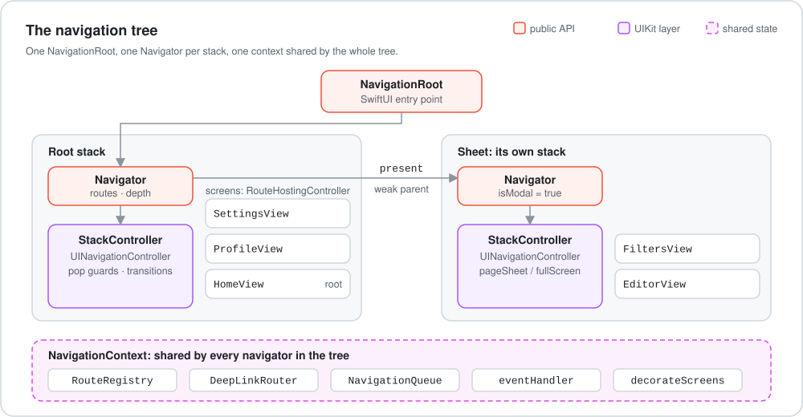
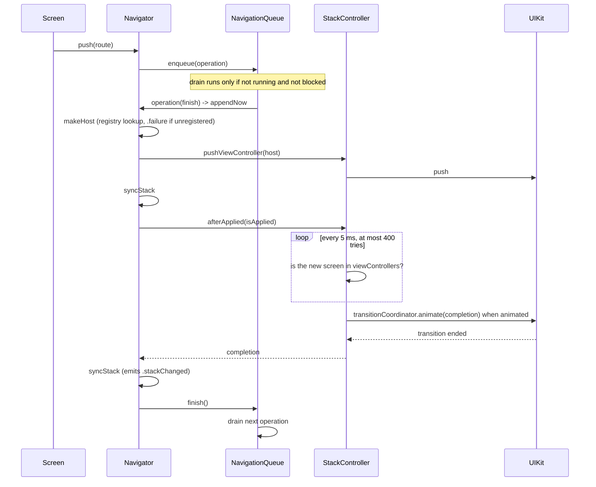
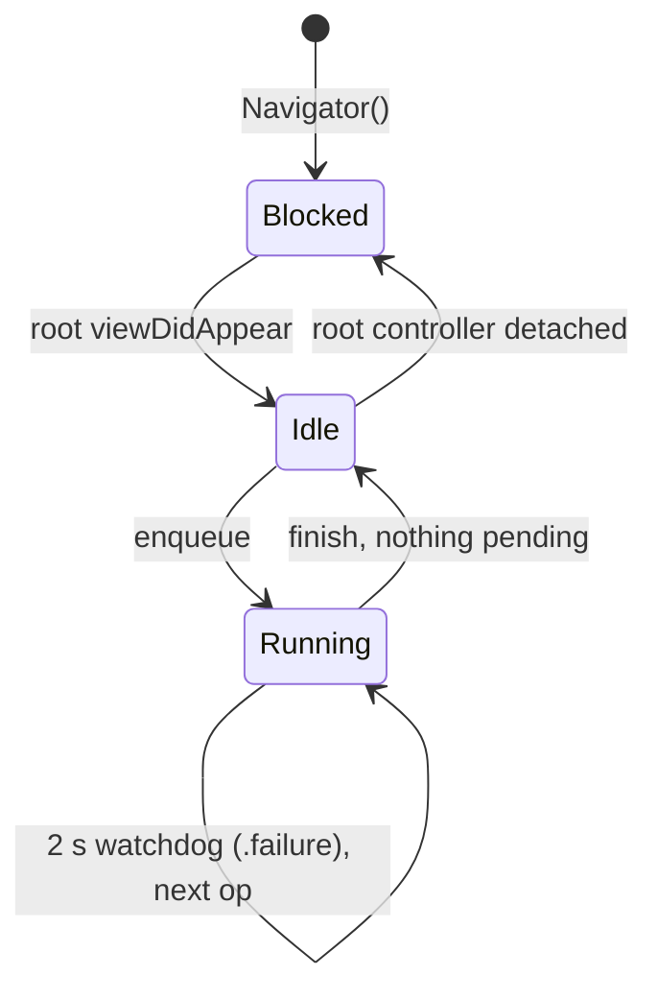
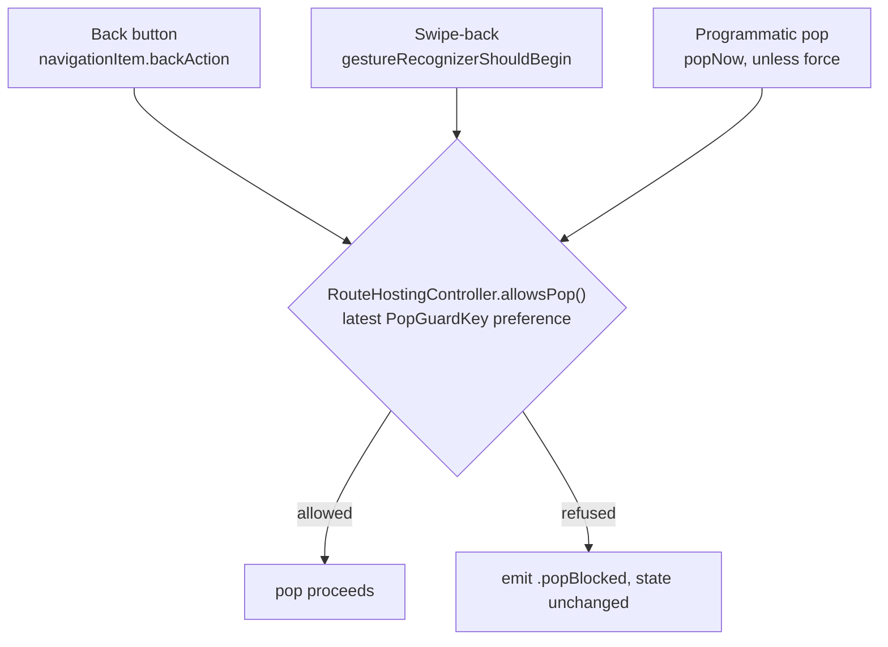
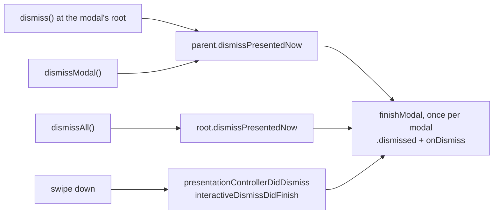
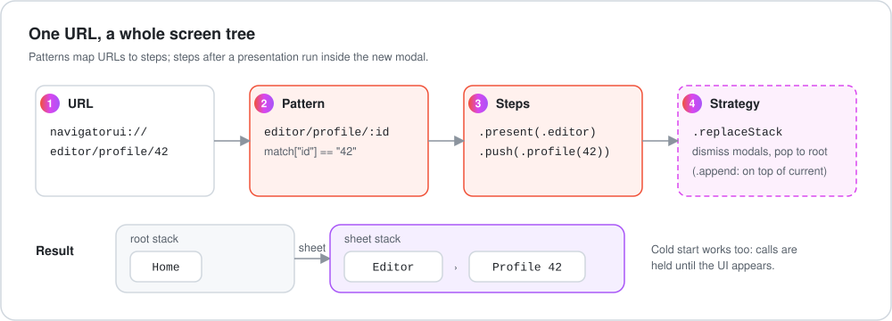

# Architecture

NavigatorUI has a SwiftUI-facing API on top (`Navigator`, `NavigationRoot`, `RouteRegistry`, `DeepLinkRouter`) and plain UIKit underneath: every stack is a `UINavigationController`, every screen a `UIHostingController`. This page explains how a call travels from a SwiftUI screen to UIKit and back. For usage, see the [README](../README.md).

## Layers

| Path (under `Sources/NavigatorUI/`) | Role |
|---|---|
| `Core/Route.swift` | `Route` (`Hashable`) and the type-erased `AnyRoute`. Presentation is never part of a route. |
| `Core/RouteRegistry.swift` | Maps a route *type* to a view builder. Views are built once, when pushed or presented. `include(_:)` merges registries. |
| `Core/Presentation.swift` | `Presentation` (sheet / full screen), `SheetDetent`, `FullScreenTransition`, `NavigationTransition`. |
| `Core/NavigationEvent.swift` | `NavigationEvent`, and `NavigationContext`: the state shared by every navigator in one tree (registry, deep links, screen decorator, event handler, queue). `fail` logs through `os.Logger` and emits `.failure`. |
| `Core/NavigationQueue.swift` | Serial queue with a gate (blocked until the root appears) and a 2 s watchdog. |
| `Navigator/Navigator.swift` | The public API. Each call enqueues an operation. |
| `Navigator/Navigator+Operations.swift` | The `...Now` methods that act on UIKit immediately and report completion; `topmost`; `run` for deep-link plans. |
| `Navigator/Navigator+Bookkeeping.swift` | Glue called by the UIKit layer: building hosts and root controllers, `syncStack`, `detach`, `controllerDidAppear`, `finishModal`. |
| `UIKit/StackController.swift` | `UINavigationController` subclass. Navigation delegate (stack sync, custom transitions), swipe-back gesture delegate (pop guards), presentation delegate (interactive sheet dismissal), and `afterApplied`. |
| `UIKit/RouteHostingController.swift` | One screen. Injects the navigator into the environment, exposes the screen's pop guard, and sets `navigationItem.backAction`. |
| `UIKit/NavigationRoot.swift` | The public SwiftUI entry point. A `UIViewControllerRepresentable` wrapper that also handles `onOpenURL` and universal links. |
| `UIKit/NavigatorEnvironment.swift` | The `\.navigator` environment key (an inert navigator by default) and the `.popGuard` modifier (a `PreferenceKey`). |
| `UIKit/FadeAnimator.swift` | The animator behind `NavigationTransition.fade`. |
| `DeepLink/DeepLinkRouter.swift` | `DeepLinkRouter`, `NavigationStep`, `DeepLinkMatch` and the internal `URLPattern`. |

  

## Object graph

- `NavigationRoot` holds the root `Navigator` in a `@StateObject` and creates its `StackController` through a `UIViewControllerRepresentable`.
- The controllers own the view tree. `Navigator.controller`, `parent` and `presented` are **weak**, so a navigator never keeps a dismissed modal alive.
- Each `presentNow` creates a child `Navigator(parent:presentedRoute:onDismiss:)` and a new `StackController`, and records it as the presenter's `presented`.
- All navigators in a tree share one `NavigationContext`: registry, deep links, screen decorator, event handler and the queue. That is why one queue serializes calls across the root and every modal.
- `topmost` walks `presented` while the next navigator still has a controller. `present` and `.append` deep links start from it.

## Life of a call

**Why "applied" is a predicate.** UIKit defers a push or pop issued in the same run-loop turn as another one: the call returns, `viewControllers` is unchanged and there is no transition coordinator yet. Treating "no coordinator" as "done" would start the next operation too early. `afterApplied` therefore waits until the change is really visible in `viewControllers`, then waits for the transition coordinator when the change is animated. The 2 s queue watchdog is the final backstop.

`animated` is downgraded to `false` when the controller is not in a window (`canAnimate`), because UIKit logs warnings and skips work when asked to animate off screen.

## Queue states

Calls made while `Blocked` are kept and run, in order, when the root `StackController` appears. That is what makes cold-start deep links work. Operations that finish synchronously (unanimated, or no-ops) run immediately, so `push(..., animated: false)` is visible right away. Queue completions capture the queue weakly: UIKit can call back after teardown.

## Pop interception

- **Back button:** `RouteHostingController` sets `navigationItem.backAction`. When the guard allows, it calls `navigator.pop(force: true)` (the guard has just been consulted); otherwise it emits `.popBlocked`.
- **Swipe-back:** `StackController` is the delegate of `interactivePopGestureRecognizer`; `gestureRecognizerShouldBegin` returns `false` and emits `.popBlocked` when the top screen refuses.
- **Programmatic:** `popNow` consults every screen it would remove, top first, unless `force` is set.

`.popGuard` publishes its closure through a `PreferenceKey`; the hosting controller keeps the latest value. Guards can run more than once per user attempt (an open item in [ROADMAP.md](ROADMAP.md)). `setStack` and `.replaceStack` deep links never consult guards.

## Modals and dismissal

- `present` always starts from `topmost`. It fails with `.failure` when the presenter has no controller, when something foreign is already presented over it, or when the route is not registered.
- `.presented` is emitted as the presentation starts; the operation finishes when UIKit's present completion runs.
- `dismissPresentedNow` calls `dismiss` on the **presenting** controller. Calling it on a modal that has its own presented modal would dismiss only the inner one. When the dismissal completes it calls `finishModal()` on the chain of presented navigators, innermost first.
- A swipe-dismiss arrives through `presentationControllerDidDismiss`, which calls `interactiveDismissDidFinish()`. That recurses into `presented` first, so modals above a swiped sheet are finished too.
- `finishModal` runs once per modal (`didFinishModal`): it clears the parent's `presented`, emits `.dismissed(route)` and calls `onDismiss`.

## Deep links

  

- `DeepLinkRouter.components(of:)` turns a URL into segments: the host is the first segment for custom schemes and ignored for `http`/`https`; `/` components are dropped.
- `URLPattern` segments are literals (case-insensitive), `:name` captures, or `*` for any one segment. The segment count must match.
- Entries are tried in registration order; the first handler that returns a non-empty plan wins. A handler returning `nil` (or `[]`) lets later patterns try.
- `Navigator.open` emits `.deepLink(url, handled:)`, then enqueues **one** operation:
  - `.replaceStack`: `dismissPresentedNow` (unanimated), then `popNow(keeping: 1, force: true)` (unanimated), then `run(steps)`.
  - `.append`: `topmost.run(steps)`.
- `run` batches consecutive pushes into a single stack change, animated only when they are the last steps. After a `.present` step it continues inside the child navigator that was just created.

## Environment and screens

`RouteHostingController.install` builds each screen as: the user's decorator output (`decorateScreens`), then `.environment(\.navigator, …)`, then `onPreferenceChange(PopGuardKey.self)`. The navigator is set *outside* the decorator, so a decorator cannot override it. Screens are built once, when pushed or presented. Views rendered outside a `NavigationRoot` read the inert default navigator, which drops and logs every call.

## Testing architecture

- `Tests/NavigatorUITests/Harness.swift` builds a real navigation tree in a real window. When hosted by the Example app it attaches to the app's `UIWindowScene`; a scene-less window in an app with scenes does not drive SwiftUI updates, so preferences such as `popGuard` would never arrive.
- A bare package test process has no window scene, and UIKit `present` never completes there. Tests that present, dismiss or animate are marked `.requiresScene` and run only through the Example app scheme.
- `Example/NavigatorUIExampleUITests` covers what unit tests cannot: real back-button and swipe-back guarding, sheets and covers, the fade transition, `setStack` and deep links.
